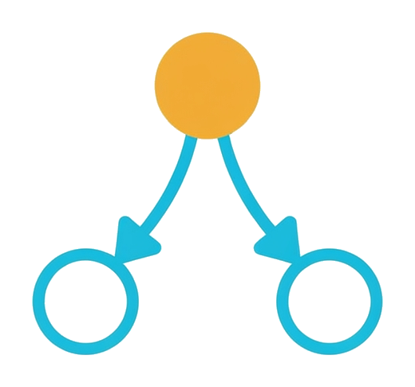
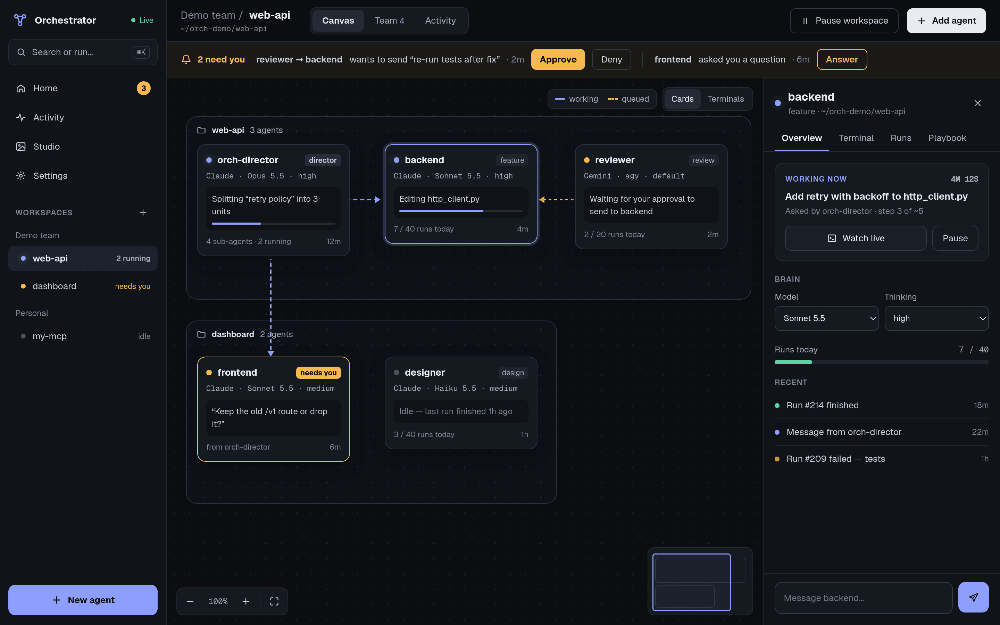
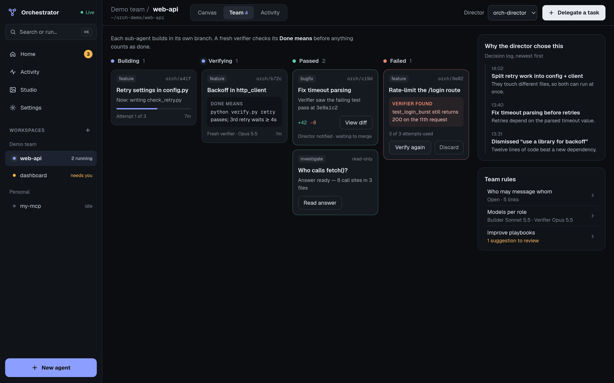
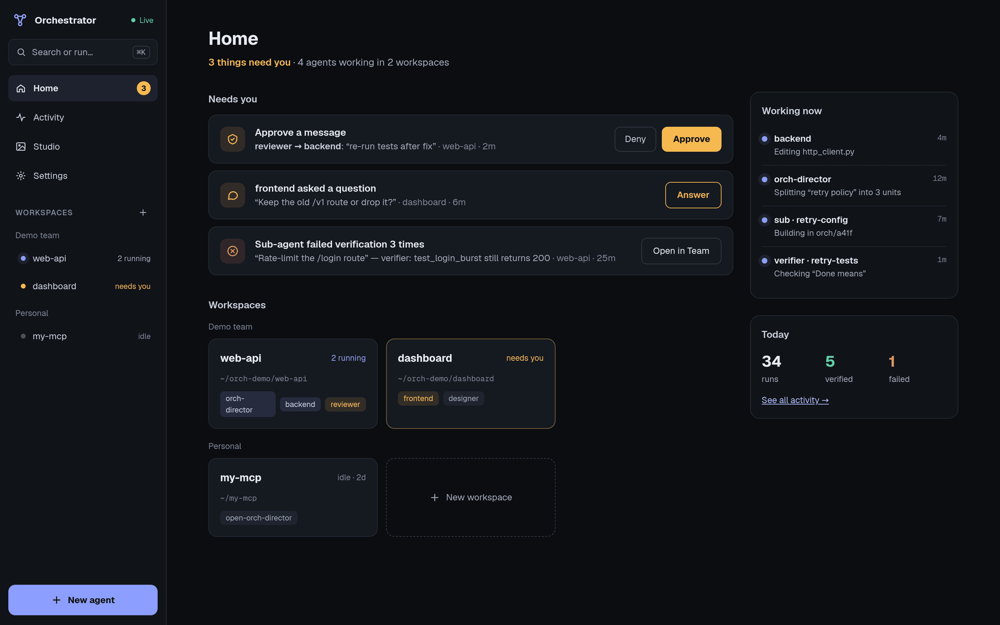

# Agent Orchestrator

Run a team of coding agents on your own machine and stay in charge of it. You talk to one
director; it splits the job across sub-agents in their own git worktrees, and nothing counts as
done until an independent verifier has seen it work.

It drives the Claude Code and Antigravity (Gemini) CLIs you already have, so each provider keeps
its own login and subscription.



[Download](../../releases) · [Report a bug](../../issues/new)

## How it works

1. **Start a director** for a repo. It is the one agent you talk to.
2. **It splits the work** and hands each unit to a sub-agent with
   `spawn_subagent(playbook, brief, done_when)`. Code is written in a worktree on branch
   `orch/<id>`; your checkout is never touched.
3. **A fresh verifier checks `done_when`**: a command and its output, a flow in the running app.
   FAIL goes back to the builder with findings; PASS tells the director which branch to merge.
4. **You step in only when needed.** Approvals, questions and failed checks land in one inbox.

## Features

**Agents**
- Live terminal cards for Claude Code and Antigravity on one canvas, with model and reasoning
  effort per agent. Gemini models are read from `agy models`, so new ones show up on their own.
- Agents hand work to each other with `send_signal`; every run is queued, capped and logged.
- Role playbooks that fill themselves in from the project.
- Workspaces (isolated folders and agents) in groups, two side by side.
- Guard rails: approval gate, ping-pong and daily caps, kill switch, one prompt at a time per
  agent, reachable from your own machine only by default.

**Director and sub-agents**
- Playbooks: `feature`, `bugfix` (reproduce first), `refactor` (record behaviour first),
  `investigate` (read-only).
- A verdict is tied to the commit that was checked; a verifier that edits files has its verdict
  thrown away. Repeated FAILs stop at a cap and tell the director.
- **Team** tab: a pipeline board (Building → Verifying → Passed / Failed) with each sub-agent's
  step, verdict and diff; the director's decision log; who may message whom; models per role;
  **Reflect**, which turns failed runs into a playbook change you approve.
- Sub-agents run on Claude; Gemini only when you pick it for a role in the Team tab.



**Staying in control**
- **Home** inbox: every message waiting for approval, every question and every failed check
  across workspaces, with Approve / Deny in place.
- **Activity**: one timeline of messages and runs, with live transcripts.
- **Ctrl/⌘K**: jump to any agent or workspace, or run any action.



## Setup

### 1. Install a provider CLI

At least one, installed and logged in:

| CLI | Install |
|---|---|
| Claude Code | [code.claude.com/docs](https://code.claude.com/docs/en/quickstart#native-install-recommended) |
| Antigravity CLI | [antigravity.google/docs/cli](https://antigravity.google/docs/cli/reference) — the `agy` command |

### 2. Install the orchestrator

**Windows (prebuilt).** Download `agent-orch-windows-x64.zip` from [Releases](../../releases).
Unblock it *before* unzipping, or SmartScreen flags every file inside:

```powershell
Unblock-File agent-orch-windows-x64.zip
```

Unzip it and run `agent-orch.exe` inside the folder. Keep the folder together. The console window
that opens is the server: close it to stop.

**Windows (from source).** PowerShell, with Python 3.12 (`winget install Python.Python.3.12`) and
Git (`winget install Git.Git`):

```powershell
git clone https://github.com/xnoname79/unity-agent-orchestrator.git
cd unity-agent-orchestrator
py -3.12 -m venv .venv
.venv\Scripts\Activate.ps1
pip install -r requirements.txt
python session_orchestrator.py serve
```

**macOS.** The `python3` built into macOS is 3.9, which is too old. Use Homebrew's:

```bash
brew install python@3.12 git
git clone https://github.com/xnoname79/unity-agent-orchestrator.git
cd unity-agent-orchestrator
python3.12 -m venv .venv && source .venv/bin/activate
pip install -r requirements.txt
python session_orchestrator.py serve
```

**Linux** (Debian, Ubuntu; Python 3.10 or newer):

```bash
sudo apt install python3 python3-venv git
git clone https://github.com/xnoname79/unity-agent-orchestrator.git
cd unity-agent-orchestrator
python3 -m venv .venv && source .venv/bin/activate
pip install -r requirements.txt
python session_orchestrator.py serve
```

Then open <http://localhost:8992>.

### 3. Connect the agents' tools

In the dashboard, open **Settings › Connections** and press **Connect** next to `signal`. It
carries messaging between agents and the director's team tools (`spawn_subagent`,
`submit_verdict`, `record_decision`…). Agents already running pick it up after a restart.

Or by hand, once per CLI:

```bash
claude mcp add --transport http --scope user signal http://127.0.0.1:8992/signal/mcp
agy mcp add signal http://127.0.0.1:8992/signal/mcp
```

### 4. Settings

Put these in a `.env` file next to `session_orchestrator.py` (or next to `agent-orch.exe`):

| Variable | Default | When to set it |
|---|---|---|
| `ORCH_PORT` | `8992` | Port 8992 is taken |
| `CLAUDE_BIN` / `ORCH_AGY_BIN` | `claude` / `agy` | The dashboard cannot find an installed CLI |
| `ORCH_HOST` | `127.0.0.1` | Only to reach it from another machine |
| `ORCH_SUBAGENTS_MAX` | `4` | Active sub-agents per director |
| `ORCH_SUBTASK_MAX_ATTEMPTS` | `3` | Failed verifications before a sub-agent's work is marked failed |

> [!WARNING]
> Agents run shell commands with permissions bypassed, and there is no API key.
> `ORCH_HOST=0.0.0.0` hands that to everyone on your network.

### 5. Keep it running (optional)

Run it as your own user, never root. Replace the paths with where you unzipped or cloned it.

<details>
<summary>Windows — Task Scheduler</summary>

```powershell
$exe = "$HOME\agent-orch-windows-x64\agent-orch.exe"
Register-ScheduledTask -TaskName "AgentOrchestrator" `
  -Action  (New-ScheduledTaskAction -Execute $exe -WorkingDirectory (Split-Path $exe)) `
  -Trigger (New-ScheduledTaskTrigger -AtLogOn) `
  -Settings (New-ScheduledTaskSettingsSet -StartWhenAvailable `
               -RestartCount 3 -RestartInterval (New-TimeSpan -Minutes 1))
```

Remove it with `Unregister-ScheduledTask -TaskName "AgentOrchestrator"`.
</details>

<details>
<summary>macOS — launchd</summary>

```bash
cat > ~/Library/LaunchAgents/com.agent-orch.plist <<PLIST
<?xml version="1.0" encoding="UTF-8"?>
<!DOCTYPE plist PUBLIC "-//Apple//DTD PLIST 1.0//EN" "http://www.apple.com/DTDs/PropertyList-1.0.dtd">
<plist version="1.0"><dict>
  <key>Label</key><string>com.agent-orch</string>
  <key>ProgramArguments</key><array>
    <string>$HOME/unity-agent-orchestrator/.venv/bin/python</string>
    <string>$HOME/unity-agent-orchestrator/session_orchestrator.py</string>
    <string>serve</string>
  </array>
  <key>WorkingDirectory</key><string>$HOME/unity-agent-orchestrator</string>
  <key>RunAtLoad</key><true/>
  <key>KeepAlive</key><true/>
  <key>StandardOutPath</key><string>$HOME/Library/Logs/agent-orch.log</string>
  <key>StandardErrorPath</key><string>$HOME/Library/Logs/agent-orch.err</string>
</dict></plist>
PLIST

launchctl load -w ~/Library/LaunchAgents/com.agent-orch.plist
```

Stop it with `launchctl unload -w ~/Library/LaunchAgents/com.agent-orch.plist`.
</details>

<details>
<summary>Linux — systemd user service</summary>

```bash
mkdir -p ~/.config/systemd/user
cat > ~/.config/systemd/user/orchestrator.service <<'UNIT'
[Unit]
Description=Agent Orchestrator
After=network-online.target
Wants=network-online.target

[Service]
Type=simple
WorkingDirectory=%h/unity-agent-orchestrator
ExecStart=%h/unity-agent-orchestrator/.venv/bin/python %h/unity-agent-orchestrator/session_orchestrator.py serve
Environment=PYTHONUNBUFFERED=1
Restart=on-failure
RestartSec=3
TimeoutStopSec=15

[Install]
WantedBy=default.target
UNIT

systemctl --user daemon-reload
systemctl --user enable --now orchestrator
loginctl enable-linger "$USER"     # start at boot, not only when you log in
```

Logs: `journalctl --user -u orchestrator -f`.
</details>

### Update

From source: `git pull`, then `pip install -r requirements.txt`, then restart. Prebuilt: download
the new zip and replace the folder, keeping your `.env`.

## Development

`python verify.py` runs every `check_*.py` (CI runs the same command). Each check guards a bug
that would otherwise fail silently — add one with any change that could.

## License

MIT — see [LICENSE](LICENSE).
