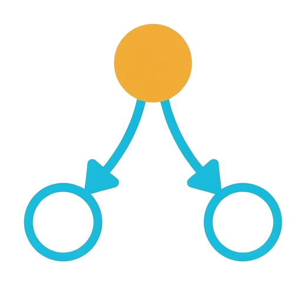
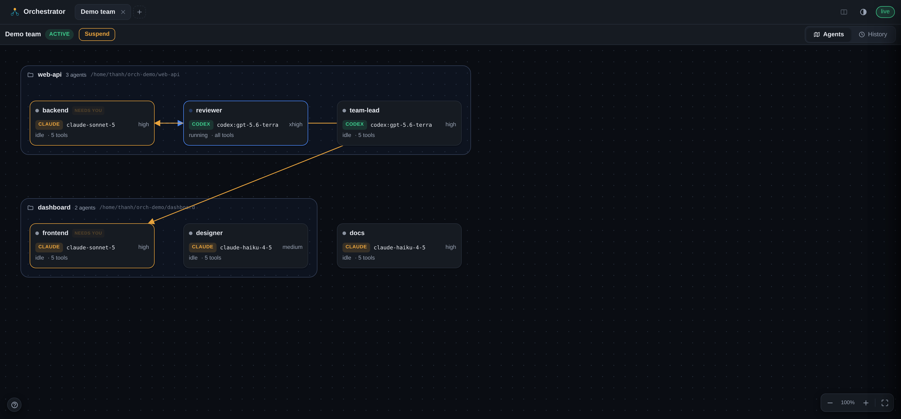
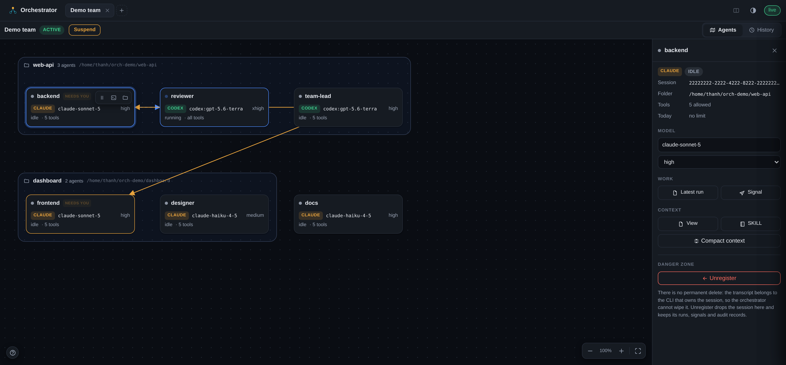
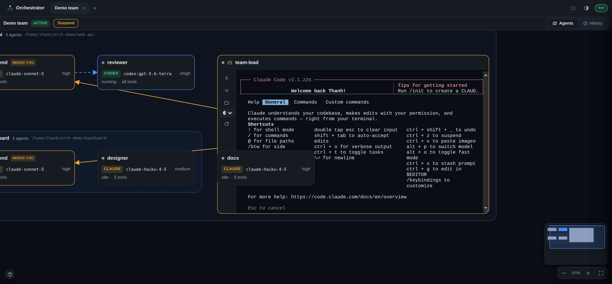
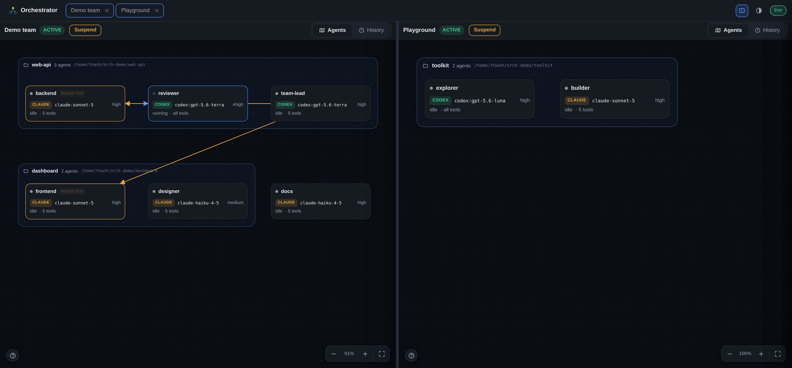
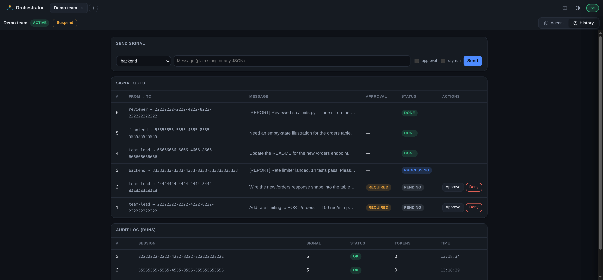

# Agent Orchestrator

Claude Code, Codex and Antigravity CLI on one canvas, signalling each other.



Each card is a live terminal you can type into. Agents pass work to each other with
`send_signal`, every run is queued and logged, and you watch it happen. The orchestrator drives
the CLIs already installed on your machine, so each provider keeps its own subscription and
login.

[Download](../../releases) · [Report a bug](../../issues/new)

## Requirements

At least one provider CLI, installed and logged in:

| CLI | Install |
|---|---|
| Claude Code | [code.claude.com/docs](https://code.claude.com/docs/en/quickstart#native-install-recommended) |
| Codex CLI | [learn.chatgpt.com/docs/codex/cli](https://learn.chatgpt.com/docs/codex/cli#getting-started) |
| Antigravity CLI | [antigravity.google/docs/cli](https://antigravity.google/docs/cli/reference) — the `agy` command |

The orchestrator finds them through the PATH of its own process. Install one while it is running
and you have to restart it. If `which claude` prints a path but the dashboard still says the
command is missing, set `CLAUDE_BIN` / `ORCH_CODEX_BIN` / `ORCH_AGY_BIN`.

Nothing else is needed to start. Agents that edit video or audio also need ffmpeg and a few
friends on your machine — see [Tools for video and audio](#tools-for-video-and-audio).

## Install

**Windows.** Download `agent-orch-windows-x64.zip` from [Releases](../../releases), unzip it, run
`agent-orch.exe` from inside the folder. Keep the folder together: the `_internal` directory next
to the `.exe` is the program. The console window that opens is the server — close it to stop.

<details>
<summary>SmartScreen may offer to <b>delete</b> the download</summary>

These builds are not code-signed, so SmartScreen has no reputation for them. Check the hash
against `SHA256SUMS.txt`, then clear the download mark. Do it on the `.zip`, before extracting —
every file inside inherits the mark.

```powershell
Get-FileHash agent-orch-windows-x64.zip -Algorithm SHA256
Unblock-File agent-orch-windows-x64.zip
```

If Defender quarantines it outright, that is a false positive on the PyInstaller bundle; report it
at [Microsoft's submission portal](https://www.microsoft.com/en-us/wdsi/filesubmission). Do not
add an exclusion — the next release is a different file and the exclusion will not cover it.
</details>

**macOS, Linux, or to work on the code.** Python 3.10+, no build step for the frontend:

```bash
git clone https://github.com/xnoname79/unity-agent-orchestrator.git
cd unity-agent-orchestrator
python3 -m venv .venv && source .venv/bin/activate     # Windows: .venv\Scripts\activate
pip install -r requirements.txt
python3 session_orchestrator.py serve
```

Open <http://localhost:8992>. The API docs are at `/docs`. The database is created on first run
under `~/.session_orch_db/`; there is no migration step. Change the port with `ORCH_PORT`.

## Let the agents reach each other

Once per CLI. Every session afterwards picks it up:

```bash
claude mcp add --transport http --scope user signal http://127.0.0.1:8992/signal/mcp
codex mcp add signal --url http://127.0.0.1:8992/signal/mcp
agy mcp add signal http://127.0.0.1:8992/signal/mcp
```

The signal server runs in-process — no second service, no extra port.

### Other MCP servers

The 🔌 button in the topbar adds any HTTP MCP server to every CLI installed here in one go, which
matters because none of them reads another's config: codex reads `~/.codex/config.toml`, agy reads
`~/.gemini/config/mcp_config.json`, claude reads `~/.claude.json`. A server added for one engine
is a tool that silently does not exist for the other two, so each row tags the CLIs that really
have it.

It also calls `tools/list` before saving — a server that refuses the token leaves every config
byte-identical, and the panel reports the tool count it got back. And the bearer token never
reaches a command line: all three CLIs take headers only through a flag, where `ps` and your shell
history can read them, so the panel writes the config entry directly. Saved tokens are never handed
back out; the API answers with the last four characters.

| Env | Default | |
|---|---|---|
| `ORCH_CLAUDE_CONFIG` | `~/.claude.json` | claude's config file |
| `ORCH_CODEX_CONFIG` | `$CODEX_HOME/config.toml` | codex's config file |
| `ORCH_AGY_MCP_CONFIG` | `~/.gemini/config/mcp_config.json` | agy's MCP config file |
| `ORCH_MCP_TIMEOUT` | `6` | seconds to wait for `tools/list` |

## Spawn an agent



**Spawn agent** asks for the group first, then a workspace inside it, then four fields:

* **Role name** — how signals find this agent, so it must be unique in the workspace. It also
  names the skill directory its playbook is written to. Rename it later by double-clicking the
  name on the card, or with the pencil in the inspector: the playbook moves to the new directory,
  signals to the new name reach it at once, and the old name keeps working, since other agents
  and the agent itself still remember it from their conversations.
* **Playbook template** — which bundled template under `.claude/skills/` seeds the role. Several
  agents can share one; they differ by role name, not by playbook.
* **Working dir** — the project the agent operates in. Leave it empty to use the workspace folder.
* **Model** — one tab per provider:

  | Tab | Values | Runs on |
  |---|---|---|
  | Claude | `opus`, `sonnet`, `haiku`, `claude-opus-4-8`, … | Claude Code CLI |
  | Codex | `codex` (auto), `codex:gpt-5.6-terra`, … | Codex CLI |
  | Gemini | `agy` (auto), `agy:gemini-3.1-pro-high`, … | Antigravity CLI |

The `codex:` and `agy:` prefixes are required. Slugs like `gpt-5.6-terra` are also valid OpenAI
API model names and `agy models` even lists `claude-*` ones, so without a prefix there is no way
to tell which CLI you meant.

Reasoning effort is one ladder across providers, clamped per model instead of failing: Claude tops
out at `max`, `codex:gpt-5.6-terra` at `ultra`, the rest at `xhigh`. Antigravity slugs carry their
own level (`…-pro-high`), so there the model is the setting.



### Playbooks fill themselves in

A template leaves its project-specific parts blank as `<UPPERCASE>` placeholders. A spawned agent
whose `SKILL.md` still has one gets a single bootstrap run: survey the working directory, fill the
blanks in. The placeholders are the flag — once gone the bootstrap never fires again, so nothing
overwrites a playbook you or the agent has edited since.

The result is written to `.claude/skills/`, `.codex/skills/` and `.agents/skills/`, because each
CLI reads only its own. A card spawned before a CLI existed shows a 🕮 button that copies the
playbook into whichever roots are missing it.

## Workspaces and groups



A **workspace** is the isolation boundary: its own folder, its own agents, and signals that never
leave it. A **group** is a drawer you file workspaces into — *work*, *hobby*, one per client — so
Home stays readable once you have a dozen. Renaming a group renames a label; deleting one re-files
its workspaces under the default group and removes nothing else.

Open two workspaces at once and the window splits, browser-style, with a live canvas in each pane.

Nothing below the dashboard knows groups exist. Routing, budgets and isolation resolve by
workspace, so moving a workspace between groups cannot change who can signal whom.

The workspace named `default` is not one of yours: it holds anything the API receives without a
`workspace_id`. The dashboard hides it while it is empty, and shows it again the moment an agent
lands in it — a hidden workspace with agents inside would be one you cannot reach.

## Browse a project

The 📁 button on a card opens a folder card clipped to the right edge of that agent's terminal,
the two framed as one block. Click a folder to go in, the breadcrumb to come back, a file to read
it; text shows as text, images as images. Drag either half and both move. It needs nothing
installed and works the same over the network.

Reads are locked inside the agent's project folder. Hidden entries (`.git`, `.env`) are not
listed, files are served read-only, and `..`, absolute paths and symlinks pointing out of the tree
are refused.

The ⧉ button opens the same folder in your own file manager — Finder, File Explorer, Nautilus —
for what a browser cannot do, like dragging a file out. That one needs the orchestrator to be
running on the machine you are sitting at; a headless install says so instead of doing nothing.

### Developer mode

Start with `--dev` (or `ORCH_DEV_MODE=1`) and 📁 opens neovim in a tmux-wrapped terminal card
instead, with a **git** tab showing [diffview.nvim](https://github.com/sindrets/diffview.nvim)
over the working tree.

```bash
python3 session_orchestrator.py --dev serve
```

That one does need neovim and tmux on the machine running the orchestrator; point
`ORCH_NVIM_BIN` / `ORCH_TMUX_BIN` at them if they are not on PATH.

The mode is picked at startup; there is no switch in the UI. Editor cards live in tmux and outlive
the orchestrator, so one opened in developer mode is still there after a plain restart — the flag
only decides what the button opens next.

## Boards: plan a day, get nudged through it

The **Boards** tab inside a workspace is a small board of your own work — not the agents' queue,
which lives in History. A board is one goal plus one agent to look after it: you name the board,
pick the agent, and write what you want done. The agent researches if it needs to, then writes the
task list for you, each task with an estimate and a priority. From there the board is yours — add,
edit, delete, and drag cards between **To do**, **Doing** and **Done**.

An agent can look after several boards, but each board has exactly one agent. **Re-plan** has it
rebuild the list from the goal; tasks you have started or finished are never touched, only the
untouched *To do* ones are replaced.

### When it nudges you

Dragging a task into *Doing* starts its clock, and the clock is what the reminders are timed from
— everything is a fraction of that task's own estimate, so a 20-minute task and a 3-hour task do
not get the same pace:

| Priority | Checked on at |
|---|---|
| high | 35%, 70% and 100% of the estimate |
| normal | 50%, 85% and 100% |
| low | only when the estimate runs out |

Past the estimate it follows up at 1.25×, 1.5×, 2× and 3× — spreading out rather than repeating.
With nothing in *Doing* it nudges you to start something instead, every 45 minutes.

Four rules sit on top of that, and they are the difference between a friend and an alarm clock:

- **Never twice in 20 minutes.** Whatever the checkpoints say, a nudge that lands too soon after
  the last one waits.
- **Ignored nudges back off.** Each one you do not answer pushes the next 1.6× further out, up to
  4× the minimum gap. Touching the board — moving a card, adding a task, asking for a nudge —
  clears the counter and the normal pace comes back.
- **Quiet hours.** Nothing between 22:00 and 08:00 by default; a nudge due then waits for morning.
  Set both ends to the same hour on the board to be reminded around the clock.
- **A couple of minutes of jitter**, fixed per board, so two boards never fire on the same tick and
  the rhythm never reads as a timer.

Nothing is stored as a schedule. The next nudge is recomputed from the state of the tasks every
time, which is why moving a card changes the pace immediately, and why restarting the orchestrator
loses nothing.

### What the agent sends back

A board does not run on the agent you chat with. Picking an agent picks a **folder** and its
settings — model, tools, permissions — and the board then opens its own session there, named
`<agent>-board`. You never chat with it, so it gets no terminal on the canvas and other agents
cannot message it; it is listed under **Board agents** in the Boards tab, with whether it is
running and how many runs it has used today. That separation is not tidiness: the terminal
you type in is a second `claude` process holding the same conversation file, and the orchestrator's
per-session lock only queues background runs against each other. Share one session between your
chat and the board and both processes append to the same transcript, where the later save can drop
the other's turns — and even when nothing is lost, the board's JSON sits in the middle of the
conversation you were having. The board agent reads the same project, keeps its own notebook, and
is deleted with the board; the agent you chat with is never touched.

It still knows what you have been doing. Before each nudge the board **reads** — never writes —
the chat between you and the agent you picked, takes what was said since its last look (your
words and the agent's replies; tool output, system text and subagents are left out), and puts the
newest 3,000 characters in the prompt. Tell your agent "login page is done" and the next nudge
points at the next task instead of asking how the login page is going. This costs no extra run,
and a nudge that fails does not move the read marker, so nothing you said is skipped. It works
with all three CLIs, so a Gemini-only setup gets the same board as a Claude or ChatGPT one.
Antigravity stores chats as undocumented protobuf in sqlite; the board decodes the two fields it
needs (what you typed, what the agent replied — never its private reasoning), and if a future agy
release moves them, the board falls back to nudging from the task list instead of breaking.

Each nudge is a real run, through the same session lock, daily run cap and audit log
as any other work — so a board shows up in History like everything else. It answers in
JSON: the line to show you, and optionally a task to retime, a task you had not thought of, and
whether it needs to research something before the next nudge. That last flag is why it does not
look things up every time: research happens when the agent says the facts it is working from have
gone stale, not once an hour. Nudges are exempt from the agent-to-agent message cap, since they
are a clock talking, not two agents in a loop.

If the agent run fails, the board still nudges you — with a line it works out itself from the
clock. A broken run is not a reason for your plan to go quiet.

Reminders arrive as a card in the corner of the dashboard, and as a desktop notification when the
window is in the background. The browser asks permission the first time you create a board, which
is the first moment the question means anything. Either way the orchestrator has to be running:
boards are not a phone app.

`ORCH_BOARD_TICK`, `ORCH_BOARD_MIN_GAP`, `ORCH_BOARD_IDLE_GAP` and `ORCH_BOARD_RESEARCH_GAP` move
the numbers above if they do not suit you.

## Make images

The picture button in the top bar opens **Images**. Describe what you want, pick a shape, press
**Generate**, and the image lands in the gallery below, usually in under a minute. Click one to
open it full size and save it from there.

- **Shape** — square, landscape (4:3, 3:2), wide 16:9, portrait (3:4, 2:3) or tall 9:16.
- **Description** — leave it on *My words, exactly*, or let a Gemini model rewrite your text into
  a fuller prompt first. Hover a picture to see the prompt it was drawn from.
- **Reference images** — up to three. Press **Reference** on a picture in the gallery, or
  **Add image…** for your own (PNG, JPEG or WebP, up to 10 MB). The new image edits, combines or
  follows them: keep a character across scenes, or change one thing in a picture.

It draws with the image tool built into the Antigravity CLI, so it runs on the Google account
`agy` is signed in with: no API key, and it counts against that account's quota. That quota is
small — in testing it ran out after a handful of images and reset a few hours later; the error
says when. Google decides which model draws; the one you pick only writes the prompt. `agy` must
be installed and signed in.

Images are kept in `~/.session_orch_db/images/`, each beside a `.json` with its prompt.

### From another app

The same drawing is served OpenAI-style, so an app on the OpenAI SDK only changes `base_url`:

```python
from openai import OpenAI

client = OpenAI(base_url="http://localhost:8992/v1", api_key="local")  # any string, none is checked

img = client.images.generate(prompt="a paper crane", size="1536x1024")
png = img.data[0].b64_json                         # base64 image bytes

client.images.edit(                                # 1-3 images to edit, combine or follow
    image=[open("crane.png", "rb")],
    prompt="fold it from red paper",
    model="agy:gemini-3.1-pro-high",               # optional: this model rewrites the prompt
)
```

- `size` picks the nearest of the seven shapes; Google decides the pixels.
- `model` is `agy:<model>` to have that model rewrite the prompt first. Anything else, an OpenAI
  model name included, draws from the prompt as given.
- `n` must be 1. `response_format="url"` returns a link on this server instead of the bytes.
- Out of quota answers `429 insufficient_quota` with the reset time, and tells the SDK not to
  retry. Every result also lands in the dashboard gallery. Full spec at `/docs`.

## Find sounds

The **Sounds** button on the top bar searches YouTube, pulls the audio out of a video and keeps it
in a library you can play, download or delete. **AI-generated only** (on by default) adds
"AI generated" to the search. Pick the format (mp3, wav, m4a, opus or flac) before you press
**Extract audio**; **Download** saves the file under the video's title.

It runs `yt-dlp` and `ffmpeg` on the machine the orchestrator runs on (see the next section). The
panel says when either is missing, and when yt-dlp is old enough that sites have likely broken it,
with the command to install or upgrade. Videos over 30 minutes and live streams cannot be
extracted. Files are kept in `~/.session_orch_db/sounds/`. A video's sound belongs to whoever made
it — the library shows a licence when the site states one; check it before you ship a sound.

Agents get the same panel as MCP tools, served at `/sounds/mcp`:

| Tool | Does |
|---|---|
| `search_videos(query, limit, ai_only)` | Searches, returns titles, links and durations |
| `extract_audio(url, format, from_role)` | Pulls the sound into the library, returns its file path |
| `list_sounds()` | What is in the library |

A sound an agent extracts appears in your library, signed with its name. Press **Give agents these
tools** in the panel to register the server with every installed CLI, or once by hand:

```bash
claude mcp add --transport http --scope user sounds http://127.0.0.1:8992/sounds/mcp
```

## Tools for video and audio

Nothing for video or audio ships with the orchestrator. The agents work by running commands in
their own terminal, so whatever is on your PATH is what they can reach for. Install these once
and every session afterwards can inspect, cut, scale and re-mix media.

The wrench in the top bar checks for you: it lists each tool, whether this machine has it, and
the command to install the ones it does not. A red dot on the button means something an agent
will reach for is not there.

| Tool | What an agent does with it |
|---|---|
| **ffmpeg** | Everything that changes a file: trim, join, scale, re-encode, crossfade between clips (`xfade`), overlay, speed, colour and blur filters, pull out frames, add or strip audio. |
| **ffprobe** | Reads a file without touching it — duration, resolution, frame rate, codecs, streams. `-v quiet -print_format json -show_streams` gives the agent something it can parse instead of guess. Comes with ffmpeg. |
| **ImageMagick** | Stills: crop, resize, composite, annotate, contact sheets, format conversion. The companion to the Images section above. |
| **yt-dlp** | Optional. Downloads a video or audio track from a URL so the agent has source material to work on. |
| **SoX** | Optional. Audio on its own: `sox --i` for a quick readout, `stat` for levels, `spectrogram` for a picture of the sound. |
| **ExifTool** | Optional. Reads and writes the metadata ffmpeg leaves alone. |

### Install them

**Windows** (PowerShell; `winget` ships with Windows 11):

```powershell
winget install Gyan.FFmpeg
winget install ImageMagick.ImageMagick
```

**macOS** ([Homebrew](https://brew.sh)):

```bash
brew install ffmpeg imagemagick sox exiftool
```

**Linux** (Debian, Ubuntu):

```bash
sudo apt install ffmpeg imagemagick sox libimage-exiftool-perl
```

yt-dlp is the exception: the version in a distro repository is usually years old and fails on
sites that have changed since. Install it from Python on any OS, and update it the same way when
a download stops working:

```bash
python3 -m pip install --upgrade yt-dlp
```

### Check they are ready

Open the wrench, install what it says is missing, then press **Re-check**. Three things to know
when one of them still misbehaves:

- **PATH is read from the orchestrator's own process.** A tool installed into a folder already on
  that PATH appears as soon as you press Re-check. An installer that *adds a new folder* to PATH —
  winget usually does — is invisible until the orchestrator is restarted, same as the provider
  CLIs.
- **`magick` is ImageMagick 7.** Debian and Ubuntu still ship version 6, where the command is
  `convert` and `magick` does not exist. The panel names whichever one your machine answers to;
  pass that name on to the agent, because one of them is *command not found*.
- **ffmpeg builds differ.** A build can be missing an encoder or filter your task needs.
  `ffmpeg -encoders` and `ffmpeg -filters` list what yours actually has — worth checking before
  blaming the command when `libx264` or `drawtext` turns up missing.

## Talk to an agent over the OpenAI API

```python
from openai import OpenAI

client = OpenAI(base_url="http://localhost:8992/v1", api_key="local")  # any string, none is checked

stream = client.chat.completions.create(
    model="<workspace_id>/<agent_alias>",          # e.g. "ws_3b99a7/backend"
    messages=[{"role": "user", "content": "Summarise today's changes"}],
    stream=True,
)
for chunk in stream:
    print(chunk.choices[0].delta.content or "", end="", flush=True)
```

It is stateful: the conversation lives in the CLI's own transcript on the server, so only the part
new since the last `assistant` message is sent on. Resending history duplicates context rather
than restoring it. One request is one real agent run — through the session lock, the daily cap and
the audit log — and a single turn can take minutes (`ORCH_CHAT_TIMEOUT`, default 900s).

## Command line

```bash
python3 session_orchestrator.py init            # create the database
python3 session_orchestrator.py serve           # dashboard + API + MCP
python3 session_orchestrator.py --dev serve     # …with the nvim editor card
python3 session_orchestrator.py once            # process pending signals once
python3 session_orchestrator.py loop            # polling daemon, no web server
python3 session_orchestrator.py list-sessions   # also: list-signals, list-runs
```

## Configuration

| Variable | Default | Purpose |
|---|---|---|
| `ORCH_PORT` / `ORCH_HOST` | `8992` / `127.0.0.1` | Where to listen; `0.0.0.0` opens it to your network |
| `ORCH_CORS_ORIGINS` | *(empty)* | Browser origins allowed to read the API; empty disables CORS |
| `CLAUDE_BIN` / `ORCH_CODEX_BIN` / `ORCH_AGY_BIN` | `claude` / `codex` / `agy` | Paths to the provider CLIs |
| `ORCH_AGY_HOME` | `~/.gemini/antigravity-cli` | Where the Antigravity CLI keeps its conversations |
| `ORCH_DEFAULT_EFFORT` | `high` | Reasoning effort when a session sets none |
| `ORCH_MAX_CONCURRENT` | `3` | Agent runs in flight at once |
| `ORCH_MAX_RUNS_PER_DAY` | `0` | Daily run cap per session; `0` is no cap |
| `ORCH_CHAT_TIMEOUT` | `900` | Seconds one `/v1` turn may take |
| `ORCH_DRY_RUN` | `0` | Simulate runs without calling any CLI |
| `ORCH_DEV_MODE` | `0` | 📁 opens an nvim card instead of the folder card (same as `--dev`) |

These can live in a `.env` file next to the executable — on Windows, inside the unzipped folder
beside `agent-orch.exe`. The full list is in the header of
[session_orchestrator.py](session_orchestrator.py).

The embedded terminal runs on ConPTY on Windows and needs Windows 10 1809 or newer. The prebuilt
build bundles it; from source, `pip install pywinpty`. `GET /health` reports `embedded_terminal`,
and `embedded_terminal_reason` when it is unavailable.

## Keep it running

Run it as your own user, never root — the provider CLIs read their logins from your home
directory. Replace the paths with wherever you unzipped or cloned it.

<details>
<summary>Windows — Task Scheduler</summary>

```powershell
$exe = "$HOME\agent-orch-windows-x64\agent-orch.exe"
Register-ScheduledTask -TaskName "AgentOrchestrator" `
  -Action  (New-ScheduledTaskAction -Execute $exe -WorkingDirectory (Split-Path $exe)) `
  -Trigger (New-ScheduledTaskTrigger -AtLogOn) `
  -Settings (New-ScheduledTaskSettingsSet -StartWhenAvailable `
               -RestartCount 3 -RestartInterval (New-TimeSpan -Minutes 1))
```

Remove it with `Unregister-ScheduledTask -TaskName "AgentOrchestrator"`.
</details>

<details>
<summary>Linux — systemd user service</summary>

```bash
mkdir -p ~/.config/systemd/user
cat > ~/.config/systemd/user/orchestrator.service <<'UNIT'
[Unit]
Description=Agent Orchestrator (dashboard + MCP, port 8992)
After=network-online.target
Wants=network-online.target

[Service]
Type=simple
WorkingDirectory=%h/unity-agent-orchestrator
ExecStart=%h/unity-agent-orchestrator/.venv/bin/python %h/unity-agent-orchestrator/session_orchestrator.py serve
Environment=PYTHONUNBUFFERED=1
Restart=on-failure
RestartSec=3
TimeoutStopSec=15

[Install]
WantedBy=default.target
UNIT

systemctl --user daemon-reload
systemctl --user enable --now orchestrator
loginctl enable-linger "$USER"     # start at boot, not only when you log in
```

Then `systemctl --user restart orchestrator` after a pull, and
`journalctl --user -u orchestrator -f` for the log. `Environment=` lines in the unit win over the
`.env` file — that is where to put `ORCH_DEV_MODE=1`.
</details>

<details>
<summary>macOS — launchd</summary>

```bash
cat > ~/Library/LaunchAgents/com.agent-orch.plist <<PLIST
<?xml version="1.0" encoding="UTF-8"?>
<!DOCTYPE plist PUBLIC "-//Apple//DTD PLIST 1.0//EN" "http://www.apple.com/DTDs/PropertyList-1.0.dtd">
<plist version="1.0"><dict>
  <key>Label</key><string>com.agent-orch</string>
  <key>ProgramArguments</key><array>
    <string>$HOME/unity-agent-orchestrator/.venv/bin/python</string>
    <string>$HOME/unity-agent-orchestrator/session_orchestrator.py</string>
    <string>serve</string>
  </array>
  <key>WorkingDirectory</key><string>$HOME/unity-agent-orchestrator</string>
  <key>RunAtLoad</key><true/>
  <key>KeepAlive</key><true/>
  <key>StandardOutPath</key><string>$HOME/Library/Logs/agent-orch.log</string>
  <key>StandardErrorPath</key><string>$HOME/Library/Logs/agent-orch.err</string>
</dict></plist>
PLIST

launchctl load -w ~/Library/LaunchAgents/com.agent-orch.plist
```

Stop it with `launchctl unload -w ~/Library/LaunchAgents/com.agent-orch.plist`.
</details>

> [!WARNING]
> Starting on boot means the port is open for as long as the machine is up. Read Safety first.

## Safety

> [!WARNING]
> There is no API key. The defaults keep it to your own machine: it listens on `127.0.0.1`,
> CORS is off, and a request carrying another website's `Origin` is refused — a page you visit
> cannot reach it even though it runs on localhost. Agents here run shell commands with
> permissions bypassed, so setting `ORCH_HOST=0.0.0.0` hands that to everyone on your network.



What keeps a room full of unattended agents from running away:

* **Approval gate** — signals marked `requires_approval` wait for a human on the dashboard.
* **Reports end the exchange** — an agent that receives work reports back once. A signal sent
  while handling work from that same agent is recognised as the report and marked one-way, so
  the receiver does not report on the report. An agent can also send a one-way request itself
  (`send_signal(..., expect_reply=False)`) when it needs nothing back. One-way signals show a
  `one-way` badge in History and a dotted arrow on the canvas.
* **Ping-pong cap** — a pair of agents gets a bounded number of exchanges per task; the budget
  reopens when a human gives new work.
* **Daily cap** — off by default; set `ORCH_MAX_RUNS_PER_DAY` and a session that hits it waits
  until you press **Allow +N**.
* **Kill switch** — global and per workspace, from the dashboard.
* **Per-session lock** — one prompt in flight per session, so transcripts never mix.
* **Audit log** — every injection recorded with status, token count and the full event stream.

**Codex sandbox.** Measured on Codex CLI 0.147.0: in headless `codex exec`, MCP tool calls only
run under `--dangerously-bypass-approvals-and-sandbox`. Everything else returns *"user cancelled
MCP tool call"*, so a sandboxed Codex agent cannot signal. The orchestrator maps `permission_mode`
straight through and warns on the timeline when signalling is off, rather than letting the hand-off
fail silently.

**Antigravity permissions.** Measured on agy 1.1.26: headless `agy -p` has nobody to ask, so any
tool needing permission is auto-denied — `call_mcp_tool` included, and with it signalling — while
the run still reports success with an empty answer. The orchestrator passes
`--dangerously-skip-permissions` when a session's `permission_mode` is `bypassPermissions` (the
default), warns when it is not, and surfaces the `denied_actions` agy reports.

The sandbox restricts writes and network, not reads. Directory boundaries between agents are a
convention in their prompts, not a kernel-enforced wall.

## Contributing

Issues and pull requests welcome. The dashboard is vanilla JS wired by string ids, so a rename
breaks it silently — the page still loads and the button just stops working. Run the checks before
opening a PR; CI runs them too.

```bash
python3 static/orchestrator/check_ui.py     # dead ids, unexported onclick, stray colours
python3 check_editor.py                     # editor + folder cards, path confinement
python3 check_inject.py                     # a slash command reaches the CLI as a command
python3 check_mcp.py                        # no config write before the token is proven
python3 check_groups.py                     # the default workspace hides only while empty
python3 check_pair_cap.py                   # the ping-pong budget reopens on new work
python3 check_workspace_move.py             # a move cannot duplicate a role name
python3 check_shutdown.py                   # Ctrl-C returns, even with an SSE stream open
python3 check_images.py                     # drawings are picked up, references stay in the gallery
python3 check_origin.py                     # a website you visit cannot drive the orchestrator
python3 check_tools.py                      # the media tool panel tells the truth about this machine
python3 check_boards.py                     # a board nudges like a friend, not an alarm clock
python3 check_sounds.py                     # a search or link never reaches yt-dlp as a flag
```

## License

No licence chosen yet, so default copyright applies: the source is public to read, not yet to
reuse. A `LICENSE` file will settle it.
